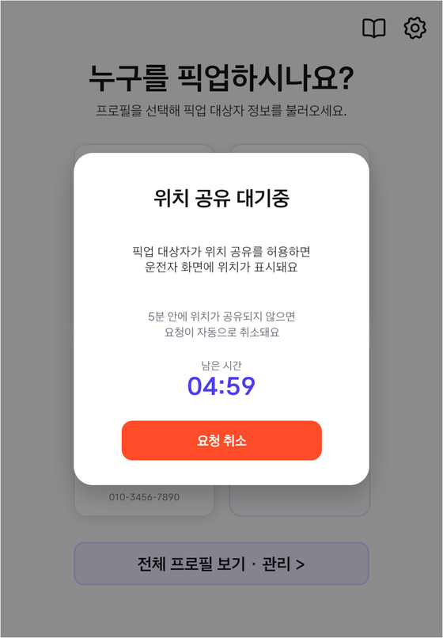
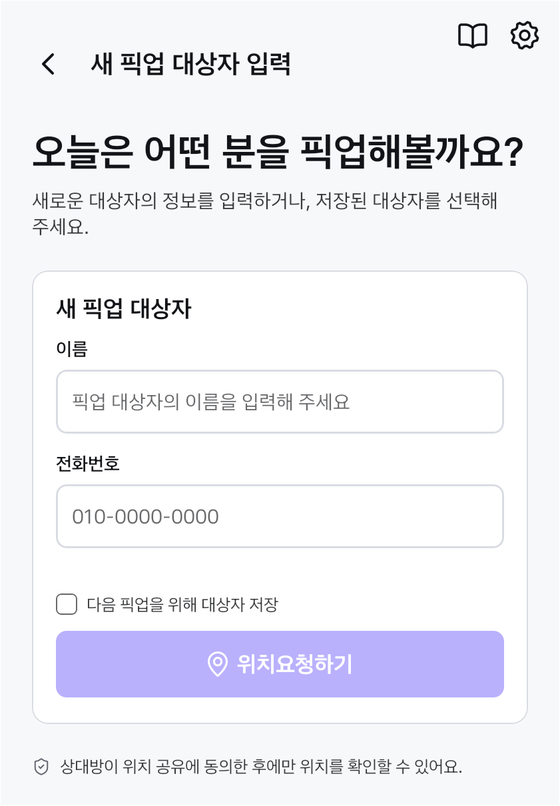
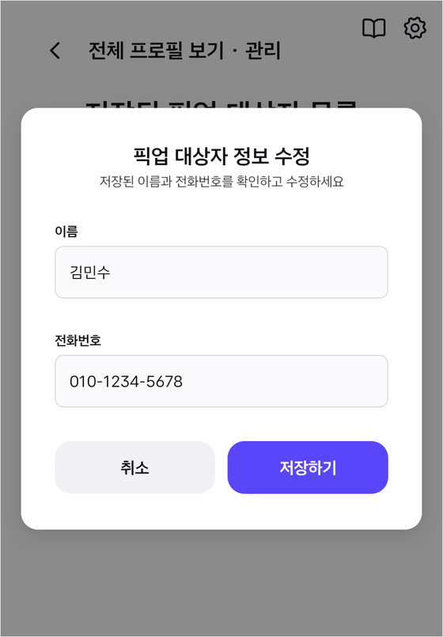
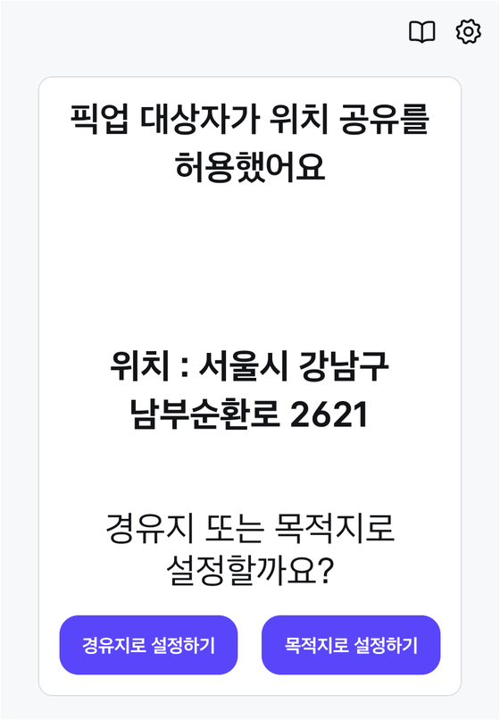
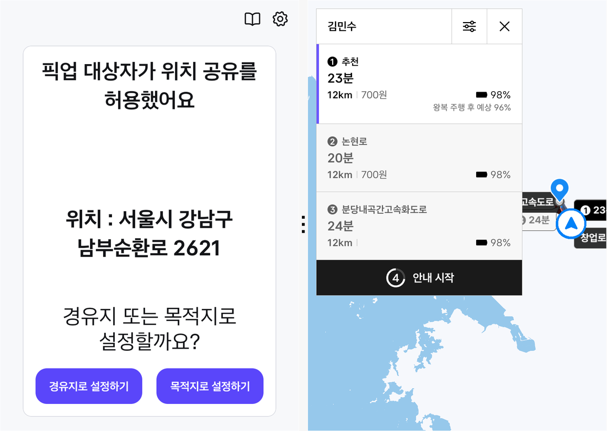
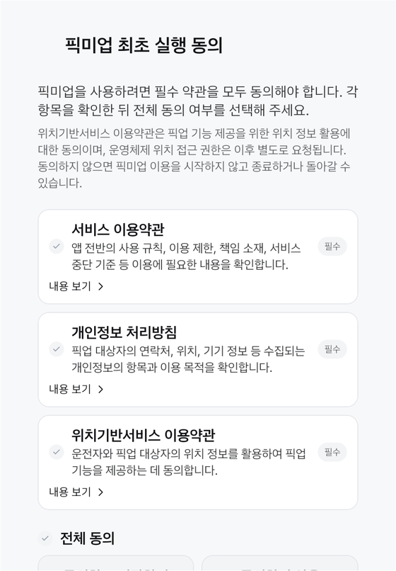
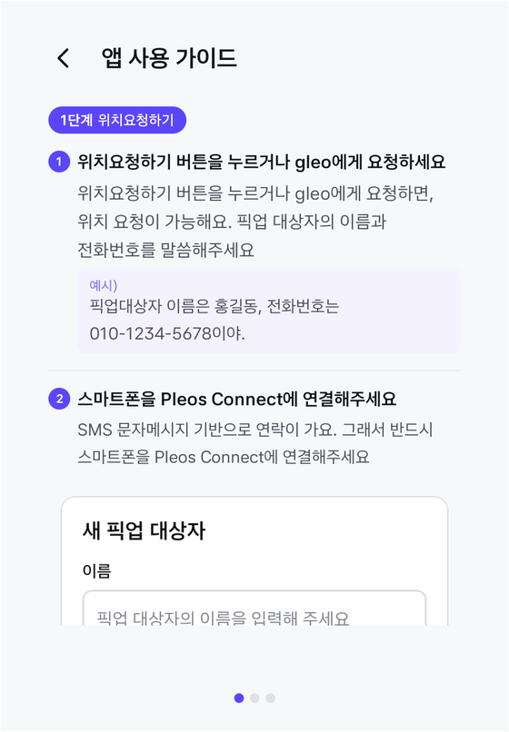

<div align="center">


# PickMeUp (AAOS)

Pleos Connect(Android Automotive OS) 차량 앱


<sub>Pleos Connect 화면 3분할 (운전자 보조 화면 | <b>PickMeUp</b> | 내비게이션)</sub>

</div>

<br />

가족이나 지인을 태우러 갈 때 운전 중에 전화로 위치를 묻고, 받은 주소를 내비에 직접 입력하는 과정을 차량 화면 몇 번의 터치로 줄인 앱입니다.

- 운전자가 차량 화면에서 픽업 대상자에게 **위치 공유 요청**
- 공유받은 위치를 **경유지/목적지로 설정**해 Pleos 내비로 바로 길안내
- 이동 중 픽업 대상자의 상황 메시지를 **알림 카드 + 음성(TTS)** 으로 안내

## 주요 기능

### 픽업 대상자 불러오기 · 위치 요청

저장해 둔 대상자 카드를 눌러 바로 위치를 요청합니다.
요청 후 대상자가 응답할 때까지 5분 카운트다운을 보여주고, 응답이 없거나 거부하면 팝업으로 알려줍니다.

<p align="center">
  
  
  
</p>

### 새 픽업 대상자 입력 · 프로필 관리

이름과 전화번호를 입력해 위치를 요청합니다. 전화번호는 하이픈이 자동으로 들어가고, 휴대전화 형식일 때만 요청 버튼이 켜집니다.
"다음 픽업을 위해 대상자 저장"을 체크하면 첫 화면에 카드로 저장되고, 목록에서 수정·삭제할 수 있습니다.

<p align="center">
  
  
  
</p>

### 경유지 / 목적지 설정 → 내비 길안내

대상자가 위치 공유를 허용하면 주소가 표시되고, **경유지** 또는 **목적지**로 설정하면 Pleos 내비가 경로를 탐색하고 안내를 시작합니다.
「경유지로 설정하기」는 길안내 중이면 기존 목적지를 그대로 두고 경유지로 추가하고, 길안내 중이 아니면 목적지로 설정합니다.

<p align="center">
  
  
</p>

### 픽업 진행 · 대상자 메시지 음성 안내

길안내 중 대상자의 상황 메시지("가는 중", "거의 도착", "대기 중")가 화면 위에서 알림 카드로 내려오고, 차량 스피커로 읽어줍니다.
알림 카드는 음성 안내가 끝날 때까지만 보이고, 픽업 위치에 도착하면 화면 문구가 도착 안내로 바뀝니다. 픽업 완료·취소 시 내비 길안내도 함께 종료됩니다.

<p align="center">
  
  
  
</p>

### 약관 동의 · 앱 사용 가이드 · 설정

첫 실행 시 필수 약관 동의를 받고, 3단계 앱 사용 가이드를 제공합니다. 설정에서 가이드와 약관을 다시 볼 수 있습니다.

<p align="center">
  
  
  
</p>

## 개발 환경 · 화면 규격

| 항목 | 내용 |
|---|---|
| 에뮬레이터 | **Pleos Connect v2.1.0** (`RELEASE.release_connect_v2.1.0`), Android 14 (API 34) |
| 시스템 이미지 | `pleos_car_emulator` arm64-v8a (42dot Inc.) |
| 차량 디스플레이 | **2560 × 1440 px**, 160 dpi (Connect-S 17", Landscape) |
| 앱 영역 | **1700 × 1184 dp** (운전자 보조 화면 \| 앱, 1:2)<br />**840 × 1184 dp** (운전자 보조 화면 \| 앱 \| 내비, 1:1:1 화면 3분할) |
| 개발 도구 | Android Studio 2026.2 |

- Figma 수치(px)를 앱 영역 너비 기준으로 dp 변환 (`ui/design/DesignScale.kt`) → 화면 3분할이나 다른 크기의 Pleos 디스플레이에서도 같은 비율로 표시
- 화면 3분할처럼 좁은 창에서는 카드 2열 배치, 팝업 폭 축소 등 레이아웃이 자동으로 바뀜 (기준: Pleos Connect display guide 2.1.5)

## 기술 스택

| 구분 | 내용 |
|---|---|
| 언어 | Kotlin 2.2 |
| UI | Jetpack Compose (BOM 2026.02.01), Material3 |
| 아키텍처 | **MVVM** (ViewModel + StateFlow), 단방향 데이터 흐름 |
| DI | Hilt |
| 화면 이동 | Navigation Compose (type-safe route) |
| 네트워크 | Retrofit 3, OkHttp 5, kotlinx.serialization |
| 차량 연동 | Pleos NaviHelper (내비), Pleos TextToSpeech (음성 안내) |
| 빌드 | AGP 9.5, Gradle Version Catalog, KSP |
| 플랫폼 | Android Automotive OS, minSdk 34 / targetSdk 37 |
| 디자인 | [Figma 와이어프레임](https://www.figma.com/design/ViO6HZxZ5M1Vc2ulAEdzDF), 폰트 Asta Sans (`res/font/asta_sans.ttf`, SIL Open Font License) |

## 아키텍처 (MVVM)

```
Screen (Compose) ── 이벤트 ──▶ ViewModel ──▶ Repository ──▶ API / SharedPreferences
       ▲                          │
       └──── UiState (StateFlow) ─┘
```

| 계층 | 역할 | 예시 |
|---|---|---|
| `XxxRoute` | ViewModel 연결, 화면 이동 처리 | `LocationRequestRoute` |
| `XxxScreen` | 상태를 받아 그리기만 함 (Preview 가능) | `LocationRequestScreen` |
| `XxxViewModel` | 화면 상태(`UiState`), 로직 | `LocationRequestViewModel` |
| `XxxRepository` | 데이터 출처 캡슐화 (interface + 구현) | `PickupRepository` |

- 상태 없는 화면(가이드, 설정, 약관 상세)은 ViewModel 없이 `Screen`만 존재
- 일회성 이벤트(화면 이동 등)는 ViewModel의 `Channel`로 전달
- 새 화면 추가: `Destinations.kt`에 경로(`XxxDestination`) 추가 → `PickMeUpNavHost.kt`에 `composable` 등록

## 프로젝트 구조

```
app/src/main/java/com/example/pickmeup/
├── PickMeUpApplication.kt   # Hilt 시작점
├── MainActivity.kt          # 약관 동의 여부로 시작 화면 결정
├── navigation/              # 화면 경로(Destinations), NavHost
├── di/                      # Hilt 모듈 (네트워크, 저장소 연결)
├── model/                   # 화면·데이터 계층 공용 모델
├── data/
│   ├── terms/               # 약관 동의 저장소 (SharedPreferences)
│   ├── pickup/              # 픽업 저장소 (Fake / Remote)
│   ├── target/              # 저장된 픽업 대상자 (SharedPreferences, 백업 제외)
│   ├── navi/                # Pleos 내비 연동 (NaviHelper SDK / Fake)
│   ├── tts/                 # Pleos 음성 안내 (TextToSpeech SDK)
│   ├── message/             # 픽업 대상자 상황 메시지 (시연용 Fake)
│   └── remote/              # Retrofit API, DTO
└── ui/
    ├── design/              # Figma px → dp/sp 변환 (기준 너비 1700px, 화면 3분할 시 840px)
    ├── theme/               # 색상, 폰트(Asta Sans), 텍스트 스타일
    ├── components/          # 공통 컴포넌트 (헤더, 설정 버튼)
    ├── terms/               # 약관 동의 / 약관 상세
    ├── target/              # 픽업 불러오기 (저장된 대상자 선택)
    ├── location/            # 위치 요청, 전화번호 검증
    ├── share/               # 공유 결과, 픽업 진행 중
    ├── guide/               # 앱 사용 가이드
    └── settings/            # 설정
```

## 주요 라이브러리

버전은 [`gradle/libs.versions.toml`](gradle/libs.versions.toml)에서 일괄 관리합니다.

| 구분 | 라이브러리 | 용도 |
|---|---|---|
| UI | Jetpack Compose BOM | Compose 라이브러리 버전 일괄 관리 |
| | Compose Material3 | Material 컴포넌트, 테마 |
| | Activity Compose | `setContent`로 Compose 화면 표시 |
| 아키텍처 | Lifecycle ViewModel Compose | ViewModel, `SavedStateHandle` |
| | Lifecycle Runtime Compose | `collectAsStateWithLifecycle` (화면이 보일 때만 상태 구독) |
| 화면 이동 | Navigation Compose | 화면 이동, type-safe route |
| DI | Hilt (Dagger) | 의존성 주입 |
| | Hilt Lifecycle ViewModel Compose | Compose에서 `hiltViewModel()` |
| 네트워크 | Retrofit | REST API 호출 |
| | Retrofit kotlinx.serialization Converter | Retrofit ↔ kotlinx.serialization 연결 |
| | OkHttp Logging Interceptor | debug 빌드 요청/응답 로그 |
| | kotlinx.serialization JSON | JSON 직렬화, Navigation 경로 직렬화 |
| 차량 연동 | Pleos NaviHelper | 내비 목적지·경유지 설정, 안내 상태 수신, 안내 종료 |
| | Pleos TextToSpeech | 픽업 대상자 메시지 음성 안내 |
| 테스트 | JUnit 4 | 단위 테스트 |
| | kotlinx-coroutines-test | ViewModel(코루틴) 테스트 |

## 실행 방법

### 1. 준비물

- Android Studio 2026.2 이상 (JDK는 Android Studio 내장 JBR 사용)
- Android SDK Platform 37 (`compileSdk 37`)
- Pleos Connect 에뮬레이터 v2.1.0

### 2. Pleos Connect 에뮬레이터 설치

1. Android Studio → **Settings → Languages & Frameworks → Android SDK → SDK Update Sites** → `+`
   - Name: `Pleos Connect System Image`
   - URL: `https://nexus-playground.pleos.ai/repository/raw-releases/connect-avd/2.x/crp-arm64-sys-img.xml`
2. **SDK Platforms** 탭 → `Show Package Details` → Android 14 (API 34) 아래 Pleos Connect 시스템 이미지(`pleos_car_emulator`) 설치
3. **Device Manager → Create Virtual Device** → Automotive 기기, 위 시스템 이미지 선택
   - 개발에 사용한 AVD: 2560 × 1440, 160 dpi, Landscape, RAM 8GB
4. 에뮬레이터 실행

### 3. 프로젝트 열기

```bash
git clone https://github.com/Team-PickMeUp/pickmeup-aaos.git
```

- Android Studio → **Open** → `pickmeup-aaos` 폴더 → Gradle Sync가 끝날 때까지 대기
- Pleos SDK는 `settings.gradle.kts`에 등록된 Pleos Maven 저장소에서 자동으로 받음

### 4. API 설정 (`local.properties`)

프로젝트 루트의 `local.properties`에 필요한 값만 적습니다 (git에 올라가지 않음). 아무것도 적지 않으면 시연용 기본값으로 실행됩니다.

```properties
pickmeup.tts.clientId=발급받은_Client_ID
pickmeup.tts.clientSecret=발급받은_Client_Secret
```

| 키 | 기본값 | 설명 |
|---|---|---|
| `pickmeup.api.useFake` | `true` | `true`면 가짜 저장소 사용 (위치 요청이 항상 즉시 '허용', 대상자 메시지는 [시연 시나리오](#6-시연-순서) 타이밍으로 재생) |
| `pickmeup.api.baseUrl` | `http://10.0.2.2:8080/` | API 주소 (기본값: 에뮬레이터에서 본 PC의 `localhost:8080`) |
| `pickmeup.navi.useFake` | `false` | `true`면 가짜 내비 사용 (Pleos 내비 서비스가 없는 일반 에뮬레이터용) |
| `pickmeup.tts.clientId` | (없음) | Pleos TextToSpeech Client ID — 없으면 음성 없이 알림 카드만 표시 |
| `pickmeup.tts.clientSecret` | (없음) | Pleos TextToSpeech Client Secret |

- http(비암호화) 접속은 debug 빌드에서 `10.0.2.2`, `localhost`만 허용

### 5. 빌드 · 실행

Android Studio에서 에뮬레이터를 켠 상태로 `app` 구성 실행(▶), 또는 명령줄:

```bash
./gradlew assembleDebug        # 빌드 (app/build/outputs/apk/debug/app-debug.apk)
./gradlew installDebug         # 에뮬레이터에 설치
adb shell am start --user 10 -n com.example.pickmeup/.MainActivity   # 실행
./gradlew testDebugUnitTest    # 단위 테스트
```

- 차량 화면 앱 목록에서 **PickMeUp** 아이콘으로도 실행 가능

### 6. 시연 순서

1. **약관 동의**: 첫 실행 시 필수 약관 3개 동의 → "동의하고 시작하기"
2. **위치 요청**: "새 픽업 대상자 입력" → 이름·전화번호 입력 → "위치요청하기" (저장된 대상자는 첫 화면 카드를 눌러 요청)
3. **위치 공유 허용**: 대기 팝업 후 "픽업 대상자가 위치 공유를 허용했어요" 화면으로 이동
4. **길안내 시작**: "목적지로 설정하기" 또는 "경유지로 설정하기" → 내비가 경로를 탐색하고 안내 시작
5. **픽업 진행** (기본 설정 `pickmeup.api.useFake=true` 기준)

   | 시점 | 동작 |
   |---|---|
   | +5초 | 알림 카드 + 음성 "픽업 대상자가 픽업 위치로 가는 중이라고 알렸어요" |
   | +10초 | 알림 카드 + 음성 "픽업 대상자가 거의 다 도착했다고 알렸어요" |
   | +15초 | 알림 카드 + 음성 "픽업 대상자가 픽업장소에서 대기중이라고 알렸어요" |
   | +20초 | 픽업 위치 도착 → 화면 문구가 도착 안내로 변경 |

6. **픽업 완료**: "픽업 완료하기" → 완료 팝업 "확인" → 내비 안내 종료, 첫 화면으로

### Pleos 에뮬레이터 참고사항

- 앱은 **사용자 10**으로 실행
- 데이터 초기화(약관 미동의 상태로 되돌리기):
  ```bash
  adb shell pm clear --user 10 com.example.pickmeup
  ```
- 상태바·GNB는 Pleos 시스템이 그림, 앱 영역은 1700×1184 (화면 3분할 시 840×1184)
- **Toast 표시 안 됨** → 사용자 안내는 화면 내 UI로 처리
- 주행 중(기어 D) 사용: `MainActivity`에 Distraction Optimized 선언 → 차단되지 않음
  - 기어 변경은 Pleos Connect Virtual Console: `adb forward tcp:8088 tcp:8088` 후 브라우저에서 http://localhost:8088 (페이지를 열어둔 동안만 조작 반영)
  - 주행 상태별 기능 제한(`CarUxRestrictions`)은 아직 없음 (정식 출시 전 필요)


## 협업

브랜치·커밋·PR·이슈 규칙과 git 사용 순서는 [GIT_GUIDE.md](GIT_GUIDE.md)를 참고하세요.
