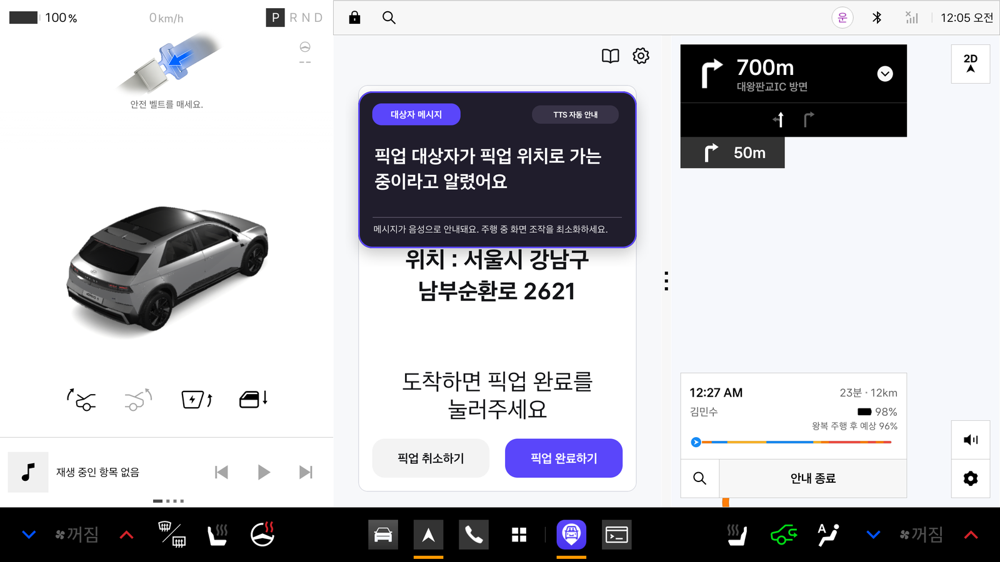
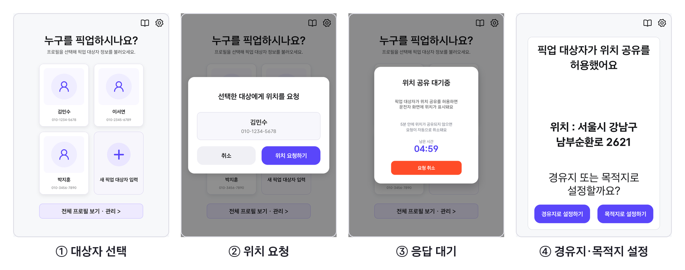
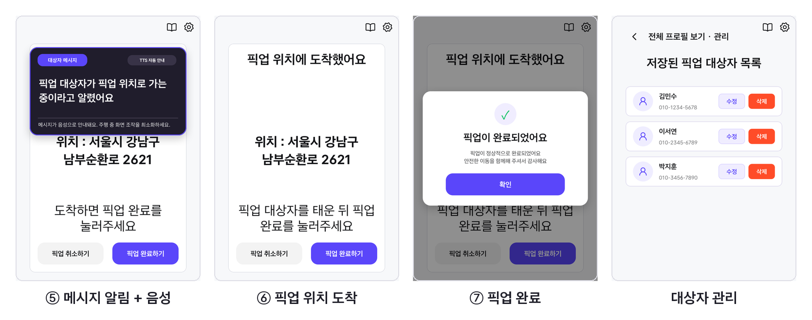

<div align="center">


# PickMeUp (AAOS)

픽업 대상자의 위치를 받아 바로 내비 길안내까지 이어주는 **Pleos Connect** 차량 앱



</div>

## 주요 기능

- **위치 요청**: 저장된 대상자 카드나 이름·전화번호 입력으로 위치 공유 요청
- **내비 연동**: 공유받은 위치를 경유지/목적지로 설정하면 Pleos 내비가 바로 길안내
- **음성 안내**: 대상자 상황 메시지를 알림 카드 + 차량 스피커(TTS)로 안내, 도착 시 안내 문구 변경




## 개발 환경 · 화면 규격

| 항목 | 내용 |
|---|---|
| 에뮬레이터 | **Pleos Connect v2.1.0** (`RELEASE.release_connect_v2.1.0`), Android 14 (API 34) |
| 차량 디스플레이 | **2560 × 1440 px**, 160 dpi |
| 앱 영역 | **1700 × 1184 dp** (1:2) / **840 × 1184 dp** (화면 3분할 1:1:1) |

- Figma px를 앱 영역 너비 기준으로 변환해, 화면 3분할 등 창 크기가 바뀌어도 같은 비율로 표시 (`ui/design/DesignScale.kt`)

## 기술 스택

| 구분 | 내용 |
|---|---|
| 언어 · UI | Kotlin, Jetpack Compose, Material3 |
| 아키텍처 | MVVM (ViewModel + StateFlow), Hilt, Navigation Compose |
| 네트워크 | Retrofit, OkHttp, kotlinx.serialization |
| 차량 연동 | Pleos NaviHelper (내비), Pleos TextToSpeech (음성 안내) |
| 플랫폼 | Android Automotive OS, minSdk 34 / targetSdk 37 |
| 디자인 | [Figma](https://www.figma.com/design/ViO6HZxZ5M1Vc2ulAEdzDF), Asta Sans 폰트 |

- 라이브러리 버전: [`gradle/libs.versions.toml`](gradle/libs.versions.toml)

## 구조

```
Screen (Compose) ── 이벤트 ──▶ ViewModel ──▶ Repository ──▶ API / SharedPreferences / Pleos SDK
       ▲                          │
       └──── UiState (StateFlow) ─┘
```

```
app/src/main/java/com/example/pickmeup/
├── navigation/   # 화면 경로, NavHost
├── di/           # Hilt 모듈
├── model/        # 공용 모델
├── data/         # terms · pickup · target · navi(NaviHelper) · tts(TextToSpeech) · message · remote
└── ui/           # design(px 변환) · theme · components · terms · target · location · share · guide · settings
```

## 실행 방법

1. **에뮬레이터 설치**: Android Studio → Settings → Android SDK → SDK Update Sites에 아래 주소 추가 → SDK Platforms의 Android 14(API 34)에서 Pleos Connect 시스템 이미지 설치 → Device Manager에서 Automotive 기기로 생성
   ```
   https://nexus-playground.pleos.ai/repository/raw-releases/connect-avd/2.x/crp-arm64-sys-img.xml
   ```
2. **프로젝트 열기**: `git clone https://github.com/Team-PickMeUp/pickmeup-aaos.git` → Android Studio로 열기 (Gradle Sync)
3. **설정 (선택)**: 프로젝트 루트 `local.properties`에 작성 (git에 올라가지 않음)

   | 키 | 기본값 | 설명 |
   |---|---|---|
   | `pickmeup.tts.clientId` / `clientSecret` | (없음) | Pleos TTS 키. 없으면 음성 없이 알림 카드만 표시 |
   | `pickmeup.api.useFake` | `true` | 시연용 가짜 서버 (위치 요청 즉시 허용, 메시지 자동 재생) |
   | `pickmeup.api.baseUrl` | `http://10.0.2.2:8080/` | API 주소 |
   | `pickmeup.navi.useFake` | `false` | Pleos 내비가 없는 일반 에뮬레이터용 가짜 내비 |

4. **실행**: 에뮬레이터를 켜고 `app` 구성 실행(▶), 또는
   ```bash
   ./gradlew installDebug
   adb shell am start --user 10 -n com.example.pickmeup/.MainActivity   # Pleos 앱은 사용자 10
   ./gradlew testDebugUnitTest   # 단위 테스트
   ```

### 시연 순서

약관 동의 → 대상자 선택(또는 새 대상자 입력) → 위치 요청 → **목적지로 설정하기** → 내비 길안내 시작 후 아래 순서로 진행 → **픽업 완료하기**

| 시점 | 동작 |
|---|---|
| +5 / 10 / 15초 | 대상자 메시지 알림 + 음성 ("가는 중" → "거의 도착" → "대기 중") |
| +20초 | 픽업 위치 도착 안내 |
| 완료 / 취소 | 결과 팝업 + 내비 안내 종료 |

### 에뮬레이터 참고

- 데이터 초기화: `adb shell pm clear --user 10 com.example.pickmeup`
- Toast가 표시되지 않음 → 안내는 화면 내 UI로 처리
- 주행 중(기어 D)에도 사용 가능 (Distraction Optimized). 기어 변경은 `adb forward tcp:8088 tcp:8088` 후 http://localhost:8088 (Virtual Console)

## 협업

브랜치·커밋·PR 규칙과 git 사용법은 [GIT_GUIDE.md](GIT_GUIDE.md) 참고
