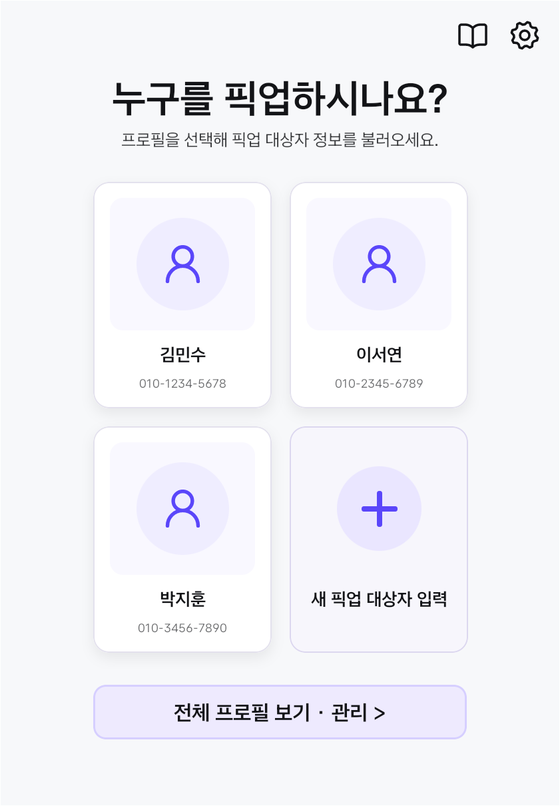
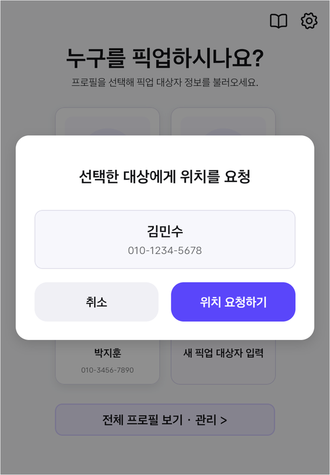
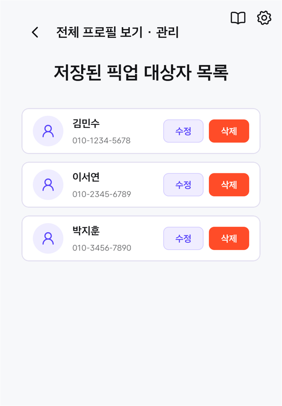
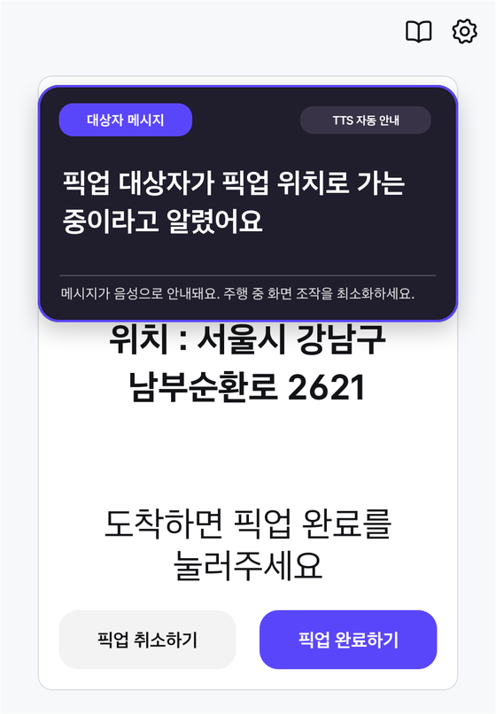
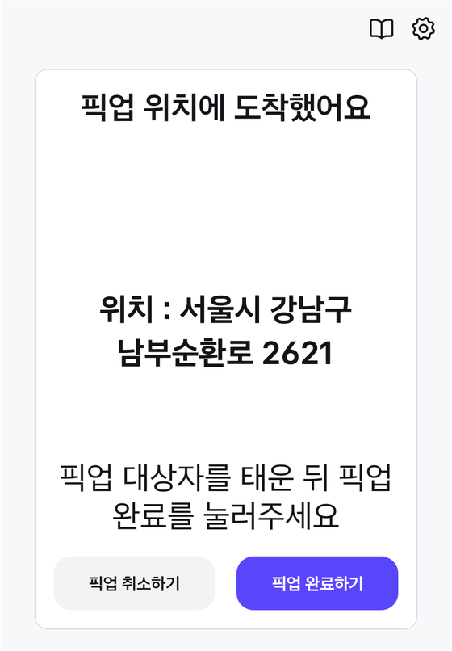
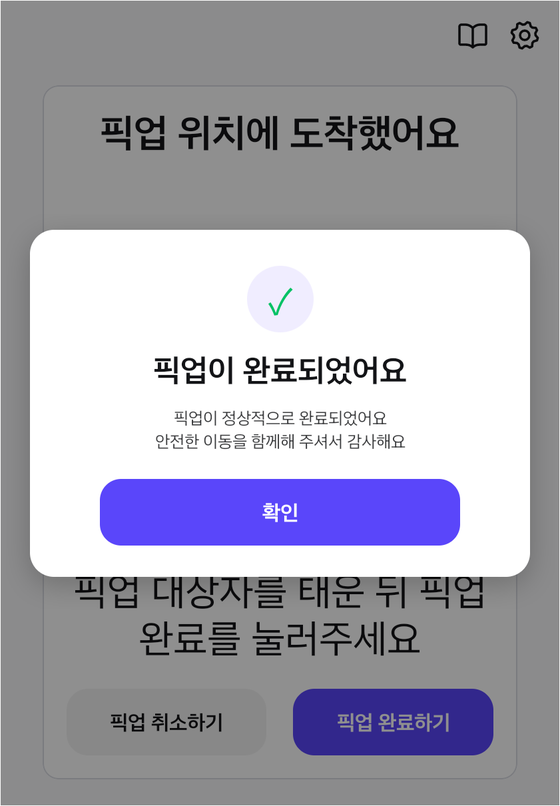
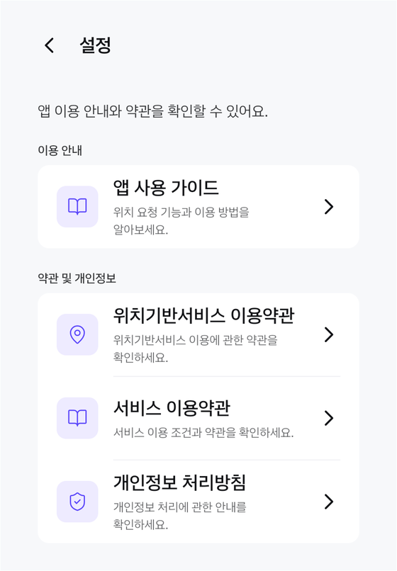

<div align="center">


# PickMeUp

**운전자가 차량 화면에서 픽업 대상자의 위치를 받아 바로 길안내까지 이어주는 Pleos Connect 앱**

`Pleos Connect` · `Android Automotive OS` · `Kotlin` · `Jetpack Compose`

<br />


<sub>Pleos Connect 화면 3분할 (운전자 보조 화면 | <b>PickMeUp</b> | 내비게이션) — 픽업 대상자 메시지를 알림 카드와 음성(TTS)으로 안내</sub>

</div>

<br />

## 📋 개발 환경 · 화면 규격

### Pleos Connect 에뮬레이터

| 항목 | 내용 |
|---|---|
| 에뮬레이터 버전 | **Pleos Connect v2.1.0** (`RELEASE.release_connect_v2.1.0`) |
| 시스템 이미지 | `pleos_car_emulator` arm64-v8a (42dot Inc., Android Automotive) |
| Android | Android 14 (API 34), build type `user` |
| Android Emulator | 37.2.13.0 |
| 앱 SDK | minSdk 34 / targetSdk 37 |

### 화면 규격

| 항목 | 규격 |
|---|---|
| 차량 디스플레이 | **2560 × 1440 px**, 160 dpi (Connect-S 17", 16:9, Landscape) |
| 앱 영역 — 1:2 (운전자 보조 화면 \| 앱) | **1700 × 1184 dp** |
| 앱 영역 — 1:1:1 화면 3분할 (운전자 보조 화면 \| 앱 \| 내비) | **840 × 1184 dp** |
| 디자인 기준 | Figma 2560 × 1440 와이어프레임, Pleos Connect display guide 2.1.5 |

- 상태바(96px)와 하단 GNB는 Pleos 시스템이 그리고, 앱은 그 사이 영역만 사용합니다.
- 앱 영역 너비에 맞춰 Figma px를 dp로 변환합니다. 그래서 화면 크기나 dpi가 다른 폼팩터에서도 같은 비율로 보입니다 ([자세히](#-화면-3분할--폼팩터-대응)).

<br />

## 💡 프로젝트 개요

가족이나 지인을 태우러 갈 때, 운전 중에 전화로 위치를 묻고 주소를 받아 내비에 직접 입력하는 일은 번거롭고 위험합니다.

**PickMeUp**은 이 과정을 차량 화면 몇 번의 터치로 줄였습니다.

1. 운전자가 차량 화면에서 픽업 대상자에게 **위치 공유를 요청**합니다 (대상자에게 문자 발송).
2. 대상자가 휴대폰에서 위치 공유를 **허용**하면, 공유받은 위치가 차량 화면에 표시됩니다.
3. 운전자가 위치를 **경유지 또는 목적지**로 설정하면 Pleos 내비게이션이 바로 길안내를 시작합니다.
4. 이동하는 동안 대상자의 상황 메시지를 **알림 카드와 음성(TTS)** 으로 전달해, 운전자는 화면을 보지 않고도 상황을 알 수 있습니다.

<br />

## ✨ 주요 기능

### 📇 픽업 대상자 불러오기 · 위치 요청

자주 태우는 사람은 프로필로 저장해 두고, 카드 한 번으로 위치를 요청합니다.
요청 후에는 대상자가 응답할 때까지 5분 카운트다운이 표시되며, 응답이 없거나 거부하면 팝업으로 알려줍니다.

<p align="center">
  
  
  
</p>

### ✍️ 새 픽업 대상자 입력 · 프로필 관리

처음 태우는 사람은 이름과 전화번호만 입력하면 됩니다. 전화번호는 자동으로 하이픈이 들어가고 휴대전화 형식일 때만 요청 버튼이 활성화됩니다.
저장한 프로필은 목록에서 수정·삭제할 수 있습니다.

<p align="center">
  
  
</p>

### 🧭 경유지 / 목적지 설정 → 내비 길안내

대상자가 위치 공유를 허용하면 주소가 표시되고, **경유지** 또는 **목적지**로 바로 설정할 수 있습니다.
Pleos **NaviHelper SDK**로 내비게이션에 위치를 넘기면, 내비가 경로를 탐색하고 안내를 시작합니다.
「경유지로 설정하기」는 길안내 중이면 기존 목적지는 그대로 두고 경유지로 추가하고, 길안내 중이 아니면 목적지로 설정합니다.

<p align="center">
  
  
</p>

### 🔊 픽업 진행 · 대상자 메시지 음성 안내

길안내 중에는 대상자가 보낸 상황 메시지(“가는 중”, “거의 도착”, “대기 중”)가 화면 위에서 알림 카드로 내려오고, Pleos **TextToSpeech SDK**로 읽어줍니다.
알림 카드는 음성 안내가 끝날 때까지만 보이고, 픽업 위치에 도착하면 화면 문구가 도착 안내로 바뀝니다.
픽업 완료·취소 시 내비 길안내도 함께 종료됩니다.

<p align="center">
  
  
  
</p>

### 📖 앱 사용 가이드 · 설정

처음 쓰는 운전자를 위한 3단계 사용 가이드와 약관·개인정보 처리방침을 제공합니다.

<p align="center">
  
  
</p>

<br />

## 🎬 시연 시나리오

심사·시연용으로 대상자 응답과 메시지를 정해진 시간에 재생합니다 (`pickmeup.api.useFake=true`, 기본값).

| 시점 | 동작 |
|---|---|
| 위치 요청 | 대상자가 즉시 위치 공유 허용 → 경유지 / 목적지 선택 화면 |
| 경유지·목적지 설정 | 실제 Pleos 내비에 위치 전달 → 경로 탐색 · 길안내 시작 → 픽업 진행 중 화면 |
| +5초 | 알림 카드 + 음성 “픽업 대상자가 픽업 위치로 가는 중이라고 알렸어요” |
| +10초 | 알림 카드 + 음성 “픽업 대상자가 거의 다 도착했다고 알렸어요” |
| +15초 | 알림 카드 + 음성 “픽업 대상자가 픽업장소에서 대기중이라고 알렸어요” |
| +20초 | 픽업 위치 도착 → 화면 문구가 도착 안내로 변경 |
| 픽업 완료 / 취소 | 결과 팝업 + 내비 길안내 종료 → 첫 화면 |

- 알림 카드는 음성 안내 길이만큼 보이고, 알림 사이에는 2초 간격을 둡니다.
- 주행 중(기어 D)에도 앱을 사용할 수 있도록 Distraction Optimized로 선언했습니다.

<br />

## 📐 화면 3분할 · 폼팩터 대응

Pleos Connect display guide 2.1.5 의 폼팩터 기준에 맞춰, 앱 영역 크기가 달라져도 화면이 창을 채우도록 만들었습니다.

| 폼팩터 | Landscape (1:2) | Portrait (1:1:1, 화면 3분할) |
|---|---|---|
| **Connect-S-17 (개발·기준)** | **1700 × 1184** | **840 × 1184** |
| Connect-S-15.6 | 1408 × 1018 | 692 × 1018 |
| Connect-S-14.6 | 1360 × 948 | 672 × 948 |
| Connect-L-12.9 | 1274 × 855 | 628 × 855 |
| Connect-W-Standard | 1640 × 810 | 800 × 810 |
| Connect-W-Extended | 1640 × 1400 | 800 × 1400 |
| Connect-WF | 1256 × 800 | 648 × 800 |

<sub>단위 dp, 출처: Pleos Connect display guide 2.1.5 「Form factors」</sub>

- **배율**: Figma px → dp 비율을 앱 영역 크기로 계산합니다 (`ui/design/DesignScale.kt`).
  - Landscape는 1700px, 화면 3분할(창 너비 < 1000dp)은 840px을 앱 영역 너비로 봅니다.
  - 창 높이 비율도 함께 반영해서 높이가 낮은 Connect-W에서도 넘치지 않습니다.
- **좁은 창 레이아웃**: 카드 2열 배치, 팝업 폭 축소, 가이드 세로 배치, 긴 문구 여러 줄 처리 등
- **가독성**: Pleos 타이포그래피 가이드에 따라 화면이 작아져도 글자는 18px 아래로 줄지 않으며, 한국어는 어절 단위로 줄바꿈합니다.

<br />

## 🔗 Pleos SDK 연동

| SDK | 버전 | 용도 |
|---|---|---|
| NaviHelper | 3.0.5 | 내비 목적지·경유지 설정, 안내 상태(경로 탐색·안내 중) 수신, 안내 종료 |
| TextToSpeech | 3.3.1 | 대상자 메시지 음성 안내, 발화 완료 시점에 맞춰 알림 카드 표시 |

- 사용 권한: `pleos.car.permission.NAVI_ROUTE`, `NAVI_ROUTE_SEARCH`, `NAVI_CUSTOM_MAP`, `TTS_SERVICE`
- TTS Client ID / Secret 은 `local.properties` 에만 두고 저장소에는 올리지 않습니다 ([API 설정](#api-설정-localproperties)).

<br />

## 기술 스택

| 구분 | 내용 |
|---|---|
| 언어 | Kotlin 2.2 |
| UI | Jetpack Compose (BOM 2026.02.01), Material3 |
| 아키텍처 | **MVVM** (ViewModel + StateFlow), 단방향 데이터 흐름 |
| DI | Hilt |
| 화면 이동 | Navigation Compose (type-safe route) |
| 네트워크 | Retrofit 3, OkHttp 5, kotlinx.serialization |
| 빌드 | AGP 9.5, Gradle Version Catalog, KSP |
| 플랫폼 | Android Automotive OS, minSdk 34 / targetSdk 37 |
| 차량 연동 | Pleos NaviHelper 3.0.5, Pleos TextToSpeech 3.3.1 |
| 디자인 | [Figma 와이어프레임](https://www.figma.com/design/ViO6HZxZ5M1Vc2ulAEdzDF) |

## 아키텍처 (MVVM)

```
Screen (Compose) ── 이벤트 ──▶ ViewModel ──▶ Repository ──▶ API / SharedPreferences
       ▲                          │
       └──── UiState (StateFlow) ─┘
```

| 계층 | 역할 | 예시 |
|---|---|---|
| `XxxRoute` | ViewModel 연결, 화면 이동 처리 | `LocationRequestRoute` |
| `XxxScreen` | 상태를 받아 그리기만 함 (Preview 가능) | `LocationRequestScreen` |
| `XxxViewModel` | 화면 상태(`UiState`), 로직 | `LocationRequestViewModel` |
| `XxxRepository` | 데이터 출처 캡슐화 (interface + 구현) | `PickupRepository` |

- 상태 없는 화면(가이드, 설정, 약관 상세)은 ViewModel 없이 `Screen`만 존재
- 일회성 이벤트(화면 이동 등)는 ViewModel의 `Channel`로 전달
- 새 화면 추가: `Destinations.kt`에 경로(`XxxDestination`) 추가 → `PickMeUpNavHost.kt`에 `composable` 등록

## 프로젝트 구조

```
app/src/main/java/com/example/pickmeup/
├── PickMeUpApplication.kt   # Hilt 시작점
├── MainActivity.kt          # 약관 동의 여부로 시작 화면 결정
├── navigation/              # 화면 경로(Destinations), NavHost
├── di/                      # Hilt 모듈 (네트워크, 저장소 연결)
├── model/                   # 화면·데이터 계층 공용 모델
├── data/
│   ├── terms/               # 약관 동의 저장소 (SharedPreferences)
│   ├── pickup/              # 픽업 저장소 (Fake / Remote)
│   ├── target/              # 저장된 픽업 대상자 (SharedPreferences, 백업 제외)
│   ├── navi/                # Pleos 내비 연동 (NaviHelper SDK / Fake)
│   ├── tts/                 # Pleos 음성 안내 (TextToSpeech SDK)
│   ├── message/             # 픽업 대상자 상황 메시지 (시연용 Fake)
│   └── remote/              # Retrofit API, DTO
└── ui/
    ├── design/              # Figma px → dp/sp 변환 (Landscape 1700px / 화면 3분할 840px 기준)
    ├── theme/               # 색상, 폰트(Asta Sans), 텍스트 스타일
    ├── components/          # 공통 컴포넌트 (헤더, 설정 버튼)
    ├── terms/               # 약관 동의 / 약관 상세
    ├── target/              # 픽업 불러오기 (저장된 대상자 선택)
    ├── location/            # 위치 요청, 전화번호 검증
    ├── share/               # 공유 결과, 픽업 진행 중
    ├── guide/               # 앱 사용 가이드
    └── settings/            # 설정
```

## 라이브러리

- 버전은 [`gradle/libs.versions.toml`](gradle/libs.versions.toml)에서 일괄 관리
- 라이브러리 추가 시 위 파일에 등록하고 아래 표도 함께 갱신

| 구분 | 라이브러리 | 버전 | 용도 |
|---|---|---|---|
| UI | Jetpack Compose BOM | 2026.02.01 | Compose 라이브러리 버전 일괄 관리 |
| | Compose Material3 | (BOM) | Material 컴포넌트, 테마 |
| | Activity Compose | 1.13.0 | `setContent`로 Compose 화면 표시 |
| 아키텍처 | Lifecycle ViewModel Compose | 2.11.0 | ViewModel, `SavedStateHandle` |
| | Lifecycle Runtime Compose | 2.11.0 | `collectAsStateWithLifecycle` (화면이 보일 때만 상태 구독) |
| 화면 이동 | Navigation Compose | 2.10.2 | 화면 이동, type-safe route |
| DI | Hilt (Dagger) | 2.60.1 | 의존성 주입 |
| | Hilt Lifecycle ViewModel Compose | 1.4.0 | Compose에서 `hiltViewModel()` |
| 네트워크 | Retrofit | 3.0.0 | REST API 호출 |
| | Retrofit kotlinx.serialization Converter | 3.0.0 | Retrofit ↔ kotlinx.serialization 연결 |
| | OkHttp Logging Interceptor | 5.5.1 | debug 빌드 요청/응답 로그 |
| | kotlinx.serialization JSON | 1.11.0 | JSON 직렬화, Navigation 경로 직렬화 |
| 차량 연동 | Pleos NaviHelper | 3.0.5 | 내비 목적지·경유지 설정, 안내 상태 |
| | Pleos TextToSpeech | 3.3.1 | 차량 스피커 음성 안내 |
| 테스트 | JUnit 4 | 4.13.2 | 단위 테스트 |
| | kotlinx-coroutines-test | 1.11.0 | ViewModel(코루틴) 테스트 |

| 빌드 플러그인 | 버전 | 용도 |
|---|---|---|
| Android Gradle Plugin | 9.5.1 | 안드로이드 빌드 |
| Kotlin Compose / Serialization | 2.2.10 | Compose 컴파일러, `@Serializable` |
| KSP | 2.3.13 | Hilt 코드 생성 |
| Hilt Gradle Plugin | 2.60.1 | Hilt 설정 |

- kotlinx.serialization 1.12 이상은 Kotlin 2.4 필요 → 1.11.0 사용 (Kotlin 업그레이드 시 함께 올릴 것)

### 리소스

| 이름 | 용도 |
|---|---|
| Asta Sans (`res/font/asta_sans.ttf`) | Figma 디자인 폰트 (가변 폰트, SIL Open Font License) |

## 실행 방법

1. Android Studio로 프로젝트 열기
2. Pleos Connect 에뮬레이터 v2.1.0 (API 34) 실행
3. `app` 구성 실행

```bash
./gradlew assembleDebug     # 빌드
./gradlew testDebugUnitTest # 단위 테스트
```

### API 설정 (`local.properties`)

| 키 | 기본값 | 설명 |
|---|---|---|
| `pickmeup.api.useFake` | `true` | `true`면 가짜 저장소 사용 (위치 요청이 항상 즉시 '허용') |
| `pickmeup.api.baseUrl` | `http://10.0.2.2:8080/` | API 주소 (기본값: 에뮬레이터에서 본 PC의 `localhost:8080`) |
| `pickmeup.navi.useFake` | `false` | `true`면 가짜 내비 사용 (Pleos 내비 서비스가 없는 일반 에뮬레이터용) |
| `pickmeup.tts.clientId` | (없음) | Pleos TextToSpeech Client ID — 없으면 음성 안내 없이 알림 카드만 표시 |
| `pickmeup.tts.clientSecret` | (없음) | Pleos TextToSpeech Client Secret |

- http(비암호화) 접속은 debug 빌드에서 `10.0.2.2`, `localhost`만 허용

### Pleos 에뮬레이터 참고사항

- 앱은 **사용자 10**으로 실행
- 데이터 초기화(약관 미동의 상태로 되돌리기):
  ```bash
  adb shell pm clear --user 10 com.example.pickmeup
  ```
- 상태바·GNB는 Pleos 시스템이 그림, 앱 영역은 1700×1184 (화면 3분할 시 840×1184)
- **Toast 표시 안 됨** → 사용자 안내는 화면 내 UI로 처리
- 주행 중(기어 D) 사용: `MainActivity`에 Distraction Optimized 선언 → 차단되지 않음
  - 기어 변경은 Pleos Connect Virtual Console: `adb forward tcp:8088 tcp:8088` 후 브라우저에서 http://localhost:8088 (페이지를 열어둔 동안만 조작 반영)
  - 주행 상태별 기능 제한(`CarUxRestrictions`)은 아직 없음 (정식 출시 전 필요)

## 협업 컨벤션

- 브랜치·커밋·PR·이슈 모두 **같은 타입** 사용 (아래 표 기준)
- git 사용 순서(처음 세팅, 매번 작업 순서, 충돌 해결): [GIT_GUIDE.md](GIT_GUIDE.md)

### 타입 & 깃모지

| 깃모지 | 타입 | 언제 | 예시 |
|:---:|---|---|---|
| ✨ | `feat` | 새 기능·화면 추가 | `✨ feat: 픽업 진행 중 화면 추가` |
| 🐛 | `fix` | 버그 수정 | `🐛 fix: 키보드가 올라오면 화면이 축소되는 문제 수정` |
| 🚑️ | `hotfix` | `main`에서 발견된 급한 버그 수정 | `🚑️ hotfix: 앱 실행 시 크래시 수정` |
| 💄 | `design` | UI·스타일만 변경 (동작 변화 없음) | `💄 design: 설정 화면 아이콘 크기 조정` |
| ♻️ | `refactor` | 동작은 그대로, 코드 구조 개선 | `♻️ refactor: 공유 화면 공통 카드 컴포넌트로 분리` |
| 🔥 | `remove` | 코드·파일 삭제 | `🔥 remove: 사용하지 않는 아이콘 삭제` |
| ✅ | `test` | 테스트 추가·수정 | `✅ test: 전화번호 검증 테스트 추가` |
| 📝 | `docs` | 문서 (README 등) | `📝 docs: 실행 방법 추가` |
| 🔧 | `chore` | 빌드 설정, 의존성, gitignore 등 | `🔧 chore: Compose BOM 업데이트` |

### 브랜치

```
타입/작업-내용          # 기본
타입/이슈번호-작업-내용  # 이슈가 있을 때
```

- `main`: 항상 빌드되는 상태 유지, **직접 push 금지**, PR로만 병합
- 작업 브랜치는 `main`에서 생성, 영어 소문자와 하이픈(`-`)만 사용
- 예: `feat/pickup-in-progress`, `fix/12-keyboard-resize`, `docs/readme`

### 커밋

```
깃모지 타입: 요약

(선택) 본문 — 무엇을, 왜 바꿨는지
```

- 요약: 한국어 50자 이내, 마침표 없이 "~ 추가 / ~ 수정 / ~ 삭제"로 끝냄
- 한 커밋에 한 가지 변경만
- 이슈 연결 시 본문에 `#12`처럼 번호 기재

### Pull Request

- **제목**: 커밋과 같은 형식 → `✨ feat: 픽업 진행 중 화면 추가`
- **본문**: PR 템플릿 자동 입력, UI 변경 시 **에뮬레이터 스크린샷 필수**
- 이슈를 닫을 때 본문에 `Closes #12` 기재
- 리뷰어 **1명 이상 승인** 후 병합
- 병합은 **Squash and merge**만 허용 (PR 제목이 `main` 커밋 메시지가 됨)
- 병합 후 작업 브랜치 자동 삭제

### 이슈

- **제목**: `깃모지 타입: 요약` → `✨ feat: 픽업 대상자 지정 화면`, `🐛 fix: 뒤로가기 시 입력값 사라짐`
- 템플릿: **기능 요청**(✨ feat) / **버그 제보**(🐛 fix)

### 흐름 한눈에

```
이슈 생성        ✨ feat: 픽업 대상자 지정 화면  (#12)
  ↓
브랜치 생성      feat/12-pickup-target
  ↓
커밋            ✨ feat: 픽업 대상자 목록 UI 추가
                💄 design: 목록 간격 Figma에 맞게 조정
  ↓
PR 생성         ✨ feat: 픽업 대상자 지정 화면 추가   (본문: Closes #12)
  ↓
리뷰 승인 → Squash and merge → 브랜치 자동 삭제
```

### 코드

- Android Studio 기본 Kotlin 코드 스타일 사용 (⌥⌘L 정렬)
- 문구는 하드코딩 금지, `res/values/strings.xml`에 작성 (큰따옴표는 `\"`로 이스케이프)
- Figma 수치(px)는 `24.px`, `34.pxSp`처럼 그대로 작성 (화면 너비에 맞춰 자동 변환)
- 텍스트 스타일은 `astaStyle(크기, 굵기, 색상, 행간배수)`(`ui/theme/Type.kt`), 색상은 `PickMeUpColors`(`ui/theme/Color.kt`) 사용
- 새 화면에는 Figma 노드 ID를 KDoc에 기재
